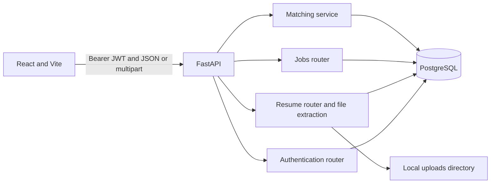

# ResumeAI — Job Resume Matcher

ResumeAI is a portfolio project for comparing resume text with job descriptions. It extracts text from PDF and DOCX files, finds skills from a built-in rule-based taxonomy, and reports matching and missing skills.

## Problem and goals

Recruiters and job seekers need a quick way to compare candidate experience with role requirements. ResumeAI provides a small authenticated workspace to save resumes and jobs, run comparisons, and review the results. The score is a skill overlap indicator; it is not a hiring recommendation or a semantic assessment of experience.

## Features

- Account registration API, password hashing, JWT login, and protected endpoints.
- PDF and DOCX upload, extraction, 10 MB file limit, and user-scoped resume listing.
- User-scoped job creation, listing, retrieval, and deletion.
- Rule-based skill extraction, matched/missing skills, and percentage calculation.
- React dashboard, resume/job management, matching results, analytics, and settings.
- Responsive sidebar and cards; match analytics are stored in the current browser, not in the database.

The frontend currently provides sign-in but not an account-registration screen. Register through `POST /auth/register` or Swagger before signing in. Logout clears the browser token; tokens are not revoked server-side and remain usable until expiry if copied.

## Technology

- Python, FastAPI, Pydantic, SQLAlchemy, PostgreSQL, Alembic
- PyJWT and `pwdlib` password hashing
- PyMuPDF and `python-docx`
- React, Vite, JavaScript, CSS
- Pytest and ESLint

## Architecture



Resume files are stored on the application filesystem and extracted text is stored in PostgreSQL. Resume list/detail APIs return metadata, not extracted resume contents or storage paths. Skills are found using a finite, configurable-in-code taxonomy; results depend on wording and the available skill list.

## Project layout

```text
app/
  core/          Settings and security helpers
  database/      SQLAlchemy engine and request sessions
  models/        User, Resume, and Job tables
  routers/       Authentication, resumes, jobs, and matching APIs
  services/      Skill extraction and match calculation
  main.py        FastAPI application and CORS setup
alembic/         Database migrations
frontend/src/    React app, components, styles, and assets
tests/           Pytest unit tests
uploads/         Local uploaded resume files (git-ignored)
```

## Database overview

`users` stores accounts and unique email addresses. `resumes` and `jobs` each reference an owning user through a foreign key and have an index on `user_id`. Alembic currently has a linear migration chain ending at `cb0f951ec001`. Apply migrations with `alembic upgrade head`; do not use `Base.metadata.create_all()` against an existing deployment.

## API endpoints

| Method | Endpoint | Purpose |
|---|---|---|
| `POST` | `/auth/register` | Create an account |
| `POST` | `/auth/login` | Form-encoded login; returns a bearer token |
| `GET` | `/auth/me` | Current authenticated account |
| `POST` | `/resumes/upload` | Upload PDF or DOCX (maximum 10 MB) |
| `GET` | `/resumes` | List the current user’s resume metadata |
| `GET`, `DELETE` | `/resumes/{resume_id}` | Read metadata or delete an owned resume |
| `POST` | `/jobs` | Create a job from JSON title and description |
| `GET` | `/jobs` | List the current user’s jobs and recognized required skills |
| `GET`, `DELETE` | `/jobs/{job_id}` | Read or delete an owned job |
| `POST` | `/match/{resume_id}/{job_id}` | Match owned resume and job records |
| `GET` | `/health` | Application health response |

Interactive API docs are available at `/docs` while the backend is running.

## Local setup

Prerequisites: Python 3.12 (or a compatible version for the pinned dependencies), Node.js/npm, and PostgreSQL.

1. Create and activate a virtual environment, then install Python packages:

   ```powershell
   python -m venv venv
   .\venv\Scripts\Activate.ps1
   python -m pip install -r requirements.txt
   ```

2. Install frontend packages:

   ```powershell
   cd frontend
   npm install
   cd ..
   ```

3. Create a PostgreSQL database and copy `.env.example` to `.env`. Set `DATABASE_URL` and replace `JWT_SECRET_KEY` with a long random secret. Keep `.env` private and out of Git.

4. Apply migrations from the project root:

   ```powershell
   .\venv\Scripts\alembic.exe upgrade head
   ```

5. Start the backend in one terminal:

   ```powershell
   .\venv\Scripts\python.exe -m uvicorn app.main:app --reload --host 127.0.0.1 --port 8001
   ```

6. Start Vite in another terminal:

   ```powershell
   cd frontend
   npm.cmd run dev -- --host 127.0.0.1
   ```

Open `http://127.0.0.1:5173`. The default API URL is `http://127.0.0.1:8001`; set frontend `VITE_API_URL` if the API is hosted elsewhere. CORS origins are configured by `CORS_ORIGINS` as a JSON array, for example `["https://resume.example.com"]` in the deployment environment.

Register an account using Swagger (`POST /auth/register`) or an HTTP client, then sign in through the frontend.

## Screenshots

Screenshots have not yet been added. Capture the dashboard, resume list, job list, and matching result using non-sensitive sample data before publishing this section.

## Tests and quality checks

Run backend tests and compilation:

```powershell
.\venv\Scripts\python.exe -m pytest -q
.\venv\Scripts\python.exe -m compileall -q app tests
```

Run frontend checks:

```powershell
cd frontend
npm.cmd run lint
npm.cmd run build
```

The committed automated suite covers skill matching/normalization, blank job validation, resume response privacy, and skill-boundary behavior. Full HTTP integration and browser tests are not currently committed. API workflows were manually exercised in the development environment; browser UI and mobile viewport testing have not been verified in this environment.

## Production deployment preparation

No deployment configuration or cloud deployment is included. A suitable architecture is:

1. Build the React app and host its static assets behind HTTPS.
2. Run FastAPI as a separately deployed application behind HTTPS.
3. Use managed PostgreSQL and run Alembic migrations as a release step.
4. Replace local `uploads/` storage with private object storage and store stable object keys in the database before using multiple backend instances. Local container disks are not a reliable persistent resume store.
5. Set `DATABASE_URL`, a unique strong `JWT_SECRET_KEY`, `ACCESS_TOKEN_EXPIRE_MINUTES`, `CORS_ORIGINS`, and `VITE_API_URL` in the respective hosting environments. Allow only the production frontend origin in production CORS.
6. Add monitoring, backups, upload retention/deletion policy, and secrets management. Verify the hosting provider’s current pricing and data-region options before selecting a service; managed databases and object storage may incur charges.

Before public production use, add server-side token revocation if immediate logout is required, rate limits for authentication and uploads, private object storage, and integration/browser tests. Do not publish real resumes or credentials in screenshots or sample data.

## Future work

- Frontend registration and password/account management.
- Persistent matching history and server-backed analytics.
- Skill taxonomy improvements and semantic matching evaluation.
- Private object storage and production retention controls.
- Automated HTTP integration tests and browser/mobile tests.
- Production deployment configuration and operational monitoring.
